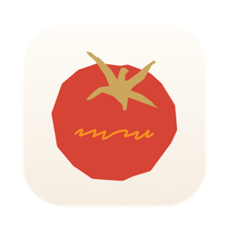

<p align="center"></p>

<h1 align="center">Tomato Done</h1>

<p align="center">番茄钟 + Done List 的 macOS 菜单栏应用。<br>每完成一个番茄钟，就在系统「日历」里自动记下一块时间——日历就是你的完成清单。</p>

<p align="center"><i>A menu bar Pomodoro timer for macOS that logs every finished session to Calendar, turning it into your done list.</i></p>

## 功能

- **菜单栏计时**：计时时菜单栏显示「类别 + 时间」胶囊，空闲时是一个番茄图标
- **倒计时 / 正计时**：倒计时左右拖动刻度尺设定 1–180 分钟；正计时自由计时
- **自定义类别**：每个类别对应「日历」中的一个日历，可以绑定已有日历，也可以新建，颜色与日历同步
- **自动记录**：倒计时到点自动完成，正计时点「完成」，事件写入对应日历；不足 1 分钟不记录
- **番茄不可分割**：没有暂停；倒计时只能放弃（点两下确认，防误触）

## 安装

1. 在 [Releases](https://github.com/ediewong/tomato-done/releases) 下载 `TomatoDone.zip`，解压后把 `TomatoDone.app` 拖进「应用程序」
2. **首次打开**：这个 App 还没有经过苹果公证，系统会拦截。打开「系统设置 › 隐私与安全性」，在下方找到 Tomato Done，点「仍要打开」。
   也可以在终端运行：
   ```bash
   xattr -dr com.apple.quarantine /Applications/TomatoDone.app
   ```
3. 点开始时允许访问日历

**系统要求**：macOS 14 及以上（Apple 芯片和 Intel 都支持）。磨砂玻璃界面效果需要 macOS 26。

## 使用

1. 点菜单栏的番茄 → 右上角设置 →「管理类别…」，添加类别（例如「学习」→ 新建同名日历，或绑定已有的「工作」日历）
2. 选择类别，输入「在做什么」（会作为日历事件的标题，留空则用类别名）
3. 选倒计时并拖动刻度尺设定时长，或选正计时，点「开始」
4. 完成后打开「日历」，就能看到这段时间已经填好了

## 从源码构建

只需要 Xcode 命令行工具，**不需要安装 Xcode**：

```bash
xcode-select --install   # 如果还没装命令行工具
./build.sh               # 构建本机版本并启动
./build.sh release       # 构建通用版本，打包成 TomatoDone.zip
```

## 项目结构

| 文件 | 内容 |
|---|---|
| `Sources/TomatoDone/App.swift` | 菜单栏面板和类别管理界面 |
| `Sources/TomatoDone/TimerModel.swift` | 计时、类别、写入日历的流程 |
| `Sources/TomatoDone/CalendarService.swift` | 用 EventKit 读写系统日历 |
| `Sources/TomatoDone/DurationRuler.swift` | 可拖动的时长刻度尺 |
| `Sources/TomatoDone/MenuBarPill.swift` | 菜单栏的计时胶囊和番茄图标 |

## 许可

[MIT](LICENSE)
